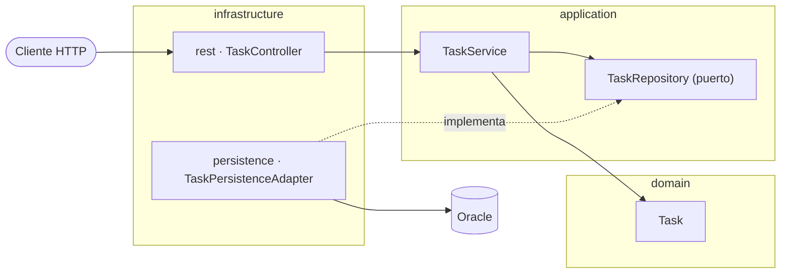

# Microservice Archetype · Java + Spring Boot + Arquitectura Hexagonal

[](https://openjdk.org/)
[](https://spring.io/projects/spring-boot)
[](https://www.oracle.com/database/free/)
[](LICENSE)

[English](README.md) · **Español**

Arquetipo de microservicio con Java 25, Spring Boot 4.2 y arquitectura hexagonal (puertos y
adaptadores). Es la contraparte backend del
[arquetipo de microfrontends](https://github.com/ingnatoz/microfrontend-archetype-react-vite) y
expone un CRUD de tareas sobre Oracle:

- **API REST**: `/api/v1/tasks`, con validación de entrada y errores en formato `ProblemDetail`
  (RFC 9457).
- **Persistencia**: Spring Data JPA sobre Oracle Database Free, con el esquema versionado por
  Flyway.
- **Pruebas**: unitarias, de contrato HTTP, de arquitectura (ArchUnit) y de integración contra un
  Oracle real (Testcontainers).

---

## Arquitectura



- Las dependencias apuntan hacia el dominio: `domain` no depende de nadie y `application` solo de
  `domain`. `ArchitectureTest` (ArchUnit) hace fallar el build si se rompe la regla.
- `Task` valida sus reglas al construirse: no existe una tarea inválida, venga de la API o de la
  base de datos.
- `TaskService` guarda a través del puerto `TaskRepository` sin conocer JPA. Flyway crea el
  esquema y Hibernate solo lo valida al arrancar.
- Los errores salen como `ProblemDetail`, sin trazas ni mensajes internos. CORS acepta solo
  orígenes exactos (por defecto, el App Shell en http://localhost:8080).
- Health check: `GET /actuator/health`, el único endpoint de Actuator expuesto. Lo consulta el
  balanceador o el orquestador; la imagen solo compila y ejecuta el jar.

---

## Estructura del proyecto

```
📦 microservice-archetype-java-spring
├── 📁 .claude                        # Claude Code: reglas, /verify, skill y agente revisor
├── 📁 Docker                         # Dockerfile y compose.yml (API y Oracle)
├── 📁 src
│   ├── 📁 main
│   │   ├── 📁 java/com/example/tasks
│   │   │   ├── 📁 domain             # Task y sus reglas, en Java puro
│   │   │   ├── 📁 application        # TaskService y el puerto TaskRepository
│   │   │   ├── 📁 infrastructure     # Adaptadores: todo lo que depende de Spring
│   │   │   │   ├── 📁 config         # Crea los casos de uso como beans
│   │   │   │   ├── 📁 persistence    # Adaptador JPA del puerto
│   │   │   │   └── 📁 rest           # Controlador, CORS y errores ProblemDetail
│   │   │   └── 📄 TasksApplication.java
│   │   └── 📁 resources
│   │       ├── 📁 db/migration       # Migraciones de Flyway
│   │       └── 📄 application.yml    # Configuración por defecto
│   └── 📁 test                       # Pruebas con la misma estructura que main
├── 📄 Makefile                       # Todos los comandos del proyecto
├── 📄 pom.xml                        # Dependencias y plugins
└── 📄 CLAUDE.md                      # Contexto del proyecto para Claude Code
```

El dominio y los casos de uso son Java puro: todo lo que depende de Spring, JPA o HTTP vive en
`infrastructure`. Las pruebas siguen los mismos paquetes.

---

## 🛠️ Requisitos

- JDK 25 y Maven 3.9
- Make
- Docker: lo usan `make run`, las pruebas (Testcontainers) y `make docker-up`, que no necesita JDK
  ni Maven

---

## Uso

- Todos los comandos están en el Makefile: `make help` los muestra.
- `make run`: arranca la API en http://localhost:8082 con un Oracle desechable.
- `make docker-up`: levanta la API y Oracle en contenedores; los datos quedan en un volumen.
- `make lint test build`: formato, pruebas y build, lo mismo que ejecuta `/verify`.
- Configuración por variables de entorno: `SPRING_DATASOURCE_URL`, `SPRING_DATASOURCE_USERNAME`,
  `SPRING_DATASOURCE_PASSWORD`, `SERVER_PORT` y `APP_CORS_ALLOWED_ORIGINS` (orígenes exactos
  separados por comas).

| Método   | Ruta                 | Respuesta                                                  |
| -------- | -------------------- | ---------------------------------------------------------- |
| `POST`   | `/api/v1/tasks`      | `201` con la tarea creada y la cabecera `Location`         |
| `GET`    | `/api/v1/tasks`      | `200` con la página pedida (`page`, `size` de 1 a 100)     |
| `GET`    | `/api/v1/tasks/{id}` | `200` con la tarea, o `404`                                |
| `PUT`    | `/api/v1/tasks/{id}` | `200` con la tarea actualizada (`title` y `done`), o `404` |
| `DELETE` | `/api/v1/tasks/{id}` | `204`, o `404`                                             |
| `GET`    | `/actuator/health`   | Health check: `200` si la API y Oracle responden, o `503`  |

```bash
curl -i http://localhost:8082/api/v1/tasks \
  -H 'Content-Type: application/json' -d '{"title": "Comprar pan"}'
```

---

## 🤖 Desarrollo con IA

El repositorio incluye configuración para [Claude Code](https://code.claude.com/docs):

- `CLAUDE.md`: contexto del proyecto (arquitectura, comandos y contratos).
- `.claude/rules`: convenciones de código.
- `/verify`: comando que ejecuta formato, pruebas y build.
- `hexagonal-use-case`: skill para agregar casos de uso con arquitectura hexagonal.
- `code-reviewer`: agente que revisa los cambios contra las convenciones.

---

## Recursos adicionales

- Arquitectura hexagonal: [artículo de Alistair Cockburn](https://alistair.cockburn.us/hexagonal-architecture/)
- Spring Boot: [Documentación oficial](https://docs.spring.io/spring-boot/)
- Problem Details: [RFC 9457](https://www.rfc-editor.org/rfc/rfc9457)
- ArchUnit: [Guía de usuario](https://www.archunit.org/userguide/html/000_Index.html)
- Testcontainers: [Documentación oficial](https://java.testcontainers.org/)
- Oracle Database Free: [imágenes de gvenzl](https://github.com/gvenzl/oci-oracle-free)
- Docker: [Documentación oficial](https://docs.docker.com/)

---

## 📄 Licencia

[MIT](LICENSE)
