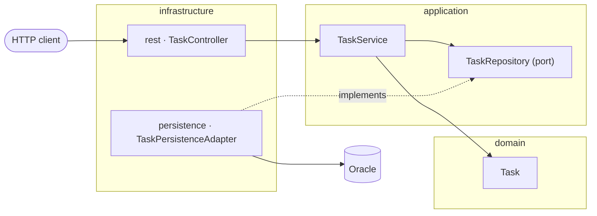

# Microservice Archetype · Java + Spring Boot + Hexagonal Architecture

[](https://openjdk.org/)
[](https://spring.io/projects/spring-boot)
[](https://www.oracle.com/database/free/)
[](LICENSE)

**English** · [Español](README.es.md)

Microservice archetype with Java 25, Spring Boot 4.2 and hexagonal architecture (ports and
adapters). It is the backend counterpart of the
[microfrontend archetype](https://github.com/ingnatoz/microfrontend-archetype-react-vite) and
exposes a task CRUD on Oracle:

- **REST API**: `/api/v1/tasks`, with input validation and errors in `ProblemDetail` format
  (RFC 9457).
- **Persistence**: Spring Data JPA on Oracle Database Free, with the schema versioned by Flyway.
- **Tests**: unit, HTTP contract, architecture (ArchUnit) and integration tests against a real
  Oracle (Testcontainers).

---

## Architecture



- Dependencies point to the domain: `domain` depends on nothing and `application` only on
  `domain`. `ArchitectureTest` (ArchUnit) fails the build if the rule breaks.
- `Task` validates its rules on construction: an invalid task cannot exist, whether it comes from
  the API or from the database.
- `TaskService` saves through the `TaskRepository` port without knowing JPA. Flyway creates the
  schema and Hibernate only validates it on startup.
- Errors leave as `ProblemDetail`, with no stack traces or internal messages. CORS accepts only
  exact origins (by default, the App Shell at http://localhost:8080).
- Health check: `GET /actuator/health`, the only Actuator endpoint exposed. The load balancer or
  the orchestrator calls it; the image only builds and runs the jar.

---

## Project structure

```
📦 microservice-archetype-java-spring
├── 📁 .claude                        # Claude Code: rules, /verify, skill and reviewer agent
├── 📁 Docker                         # Dockerfile and compose.yml (API and Oracle)
├── 📁 src
│   ├── 📁 main
│   │   ├── 📁 java/com/example/tasks
│   │   │   ├── 📁 domain             # Task and its rules, in plain Java
│   │   │   ├── 📁 application        # TaskService and the TaskRepository port
│   │   │   ├── 📁 infrastructure     # Adapters: everything that depends on Spring
│   │   │   │   ├── 📁 config         # Creates the use cases as beans
│   │   │   │   ├── 📁 persistence    # JPA adapter for the port
│   │   │   │   └── 📁 rest           # Controller, CORS and ProblemDetail errors
│   │   │   └── 📄 TasksApplication.java
│   │   └── 📁 resources
│   │       ├── 📁 db/migration       # Flyway migrations
│   │       └── 📄 application.yml    # Default configuration
│   └── 📁 test                       # Tests with the same structure as main
├── 📄 Makefile                       # Every project command
├── 📄 pom.xml                        # Dependencies and plugins
└── 📄 CLAUDE.md                      # Project context for Claude Code
```

The domain and the use cases are plain Java: everything that depends on Spring, JPA or HTTP lives
in `infrastructure`. The tests follow the same packages.

---

## 🛠️ Requirements

- JDK 25 and Maven 3.9
- Make
- Docker: used by `make run`, the tests (Testcontainers) and `make docker-up`, which needs neither
  JDK nor Maven

---

## Usage

- Every command is in the Makefile: `make help` lists them.
- `make run`: starts the API on http://localhost:8082 with a throwaway Oracle.
- `make docker-up`: starts the API and Oracle in containers; the data stays in a volume.
- `make lint test build`: formatting, tests and build, the same steps `/verify` runs.
- Configuration through environment variables: `SPRING_DATASOURCE_URL`,
  `SPRING_DATASOURCE_USERNAME`, `SPRING_DATASOURCE_PASSWORD`, `SERVER_PORT` and
  `APP_CORS_ALLOWED_ORIGINS` (exact origins separated by commas).

| Method   | Path                 | Response                                                     |
| -------- | -------------------- | ------------------------------------------------------------ |
| `POST`   | `/api/v1/tasks`      | `201` with the created task and the `Location` header        |
| `GET`    | `/api/v1/tasks`      | `200` with the requested page (`page`, `size` from 1 to 100) |
| `GET`    | `/api/v1/tasks/{id}` | `200` with the task, or `404`                                |
| `PUT`    | `/api/v1/tasks/{id}` | `200` with the updated task (`title` and `done`), or `404`   |
| `DELETE` | `/api/v1/tasks/{id}` | `204`, or `404`                                              |
| `GET`    | `/actuator/health`   | Health check: `200` if the API and Oracle respond, or `503`  |

```bash
curl -i http://localhost:8082/api/v1/tasks \
  -H 'Content-Type: application/json' -d '{"title": "Buy bread"}'
```

---

## 🤖 AI-assisted development

The repository includes configuration for [Claude Code](https://code.claude.com/docs):

- `CLAUDE.md`: project context (architecture, commands and contracts).
- `.claude/rules`: code conventions.
- `/verify`: command that runs formatting, tests and build.
- `hexagonal-use-case`: skill to add use cases with hexagonal architecture.
- `code-reviewer`: agent that reviews changes against the conventions.

---

## Additional resources

- Hexagonal architecture: [Alistair Cockburn's article](https://alistair.cockburn.us/hexagonal-architecture/)
- Spring Boot: [Official documentation](https://docs.spring.io/spring-boot/)
- Problem Details: [RFC 9457](https://www.rfc-editor.org/rfc/rfc9457)
- ArchUnit: [User guide](https://www.archunit.org/userguide/html/000_Index.html)
- Testcontainers: [Official documentation](https://java.testcontainers.org/)
- Oracle Database Free: [gvenzl images](https://github.com/gvenzl/oci-oracle-free)
- Docker: [Official documentation](https://docs.docker.com/)

---

## 📄 License

[MIT](LICENSE)
